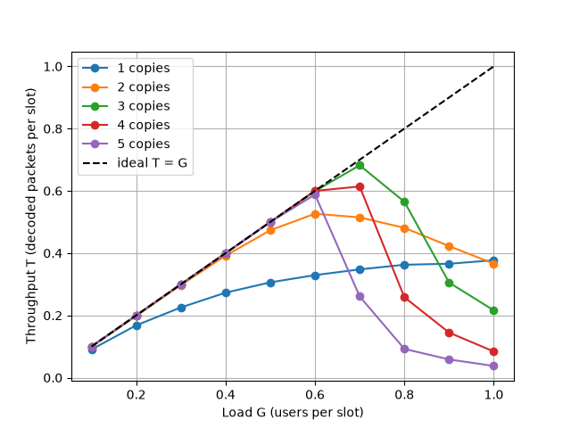
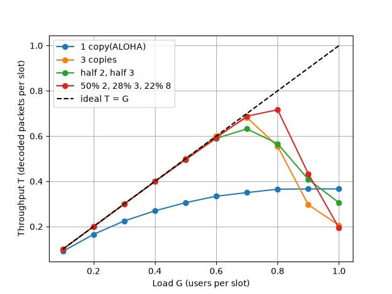
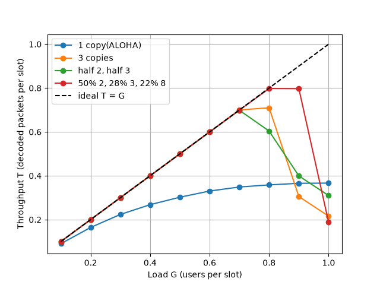
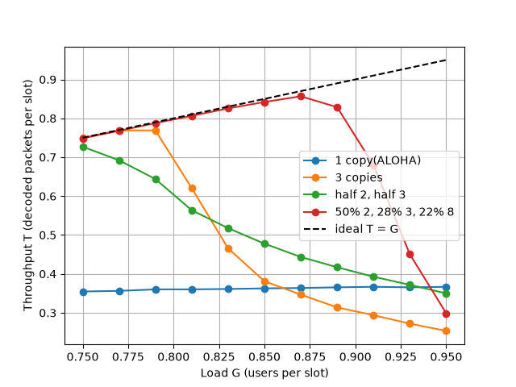
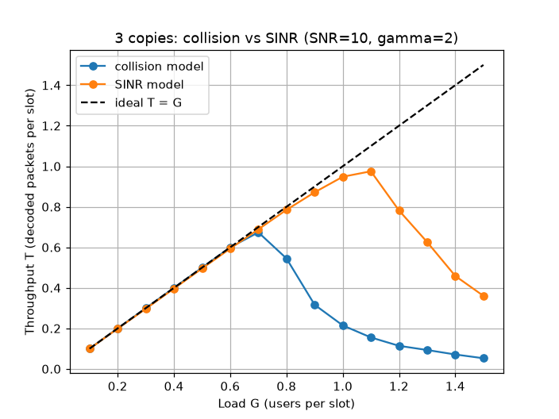

# IRSA 隨機接取模擬（Irregular Repetition Slotted ALOHA）

以 Python 實作 IRSA（Irregular Repetition Slotted ALOHA）的蒙地卡羅模擬，
比較不同副本數分布下的傳輸量，並重現 slotted ALOHA 與 IRSA 文獻中的幾個經典結果。

這是我為了理解大量 IoT 裝置隨機接取（random access）問題所做的自學專案。

## 背景

大量裝置（例如感測器）要把短封包傳給同一個基地台，但彼此沒有協調。
時間被切成一個個時槽（slot），一組時槽稱為一個 frame。

- **Slotted ALOHA**：每個使用者隨機挑一個時槽傳送一次；同一時槽有兩人以上就碰撞、全部失敗。
- **IRSA**：每個使用者把封包複製成數份副本（replica），丟進同一個 frame 中不同的時槽；
  副本數依照一個機率分布決定。接收端用**連續干擾消除（SIC）**解碼：
  1. 找出只有一個封包的時槽，解出該使用者；
  2. 從其他時槽扣掉這個使用者的副本；
  3. 可能因此產生新的「只剩一個封包」的時槽，重複直到無法再解。

## 模型假設

- 碰撞通道（collision channel）：時槽中只有一個封包一定解得出來，兩個以上一定解不出來；不考慮雜訊與衰落。
- 完美的干擾消除：扣掉副本後沒有殘餘干擾。
- 每個封包剛好佔一個時槽；解出任一副本即可知道其他副本的位置。

## 衡量指標

- **負載 G**：平均每個時槽的使用者數，G = 使用者數 / 時槽數。
- **傳輸量 T**：平均每個時槽成功解出的封包數。理想情況（所有人都解出）為 T = G。
- **解碼門檻**：在幾乎所有人都能解出的前提下，G 最高能到多少。

## 程式說明

| 檔案 | 內容 |
|---|---|
| `irsa_simulation.py` | 碰撞模型下的 IRSA 模擬，比較不同副本數分布（結果 1～3） |
| `irsa_sinr.py` | 延伸：加入衰落與 SINR 門檻，與碰撞模型比較（結果 4） |

- `simulate_frame(n_users, n_slots, degrees, probs, rng)`：模擬一個 frame，回傳解出的人數。
  每個使用者依照機率 `probs` 從 `degrees` 中抽出自己的副本數。
- 主程式對每個負載 G 跑多個 frame（預設 200 個）取平均，畫出 T 對 G 的曲線。
- 使用固定的隨機種子（`np.random.default_rng(0)`），結果可重現。

比較的分布：

| 名稱 | 副本數分布 |
|---|---|
| 1 copy（slotted ALOHA） | 100% 傳 1 份 |
| 3 copies | 100% 傳 3 份 |
| half 2, half 3 | 50% 傳 2 份、50% 傳 3 份 |
| Liva (2011) | 50% 傳 2 份、28% 傳 3 份、22% 傳 8 份，即 Λ(x) = 0.5x² + 0.28x³ + 0.22x⁸ |

## 結果

### 1. 固定副本數 1～5 份（每個 frame 100 個時槽）



- 1 份副本（slotted ALOHA）的傳輸量最高約 0.37，與理論值 1/e ≈ 0.368 一致。
- 副本數不是越多越好：在固定副本數中，3 份的表現最好。
  副本太多會讓時槽過於擁擠（每格平均副本數 = 平均副本數 × G），剝洋蔥無法啟動。

### 2. 不規則分布的比較（100 個時槽）



- Liva (2011) 的分布在 G = 0.8 時仍接近理想線，明顯優於固定 3 份。
- half 2, half 3 的最高點較低，但負載超過門檻後下降得較慢。

### 3. 加大 frame：1000 個時槽




- frame 加大後，各分布的門檻都往理論值靠近，且超過門檻後下降得更陡。
- 在我的模擬中，3 copies 大約在 G ≈ 0.78 前貼著理想線（文獻中的理論門檻約 0.82）；
  Liva 分布大約在 G ≈ 0.87 前貼著理想線（文獻中的理論門檻為 0.938，為 frame 無限大時的值）。

## 延伸：加入衰落與 SINR 門檻

碰撞模型只看「時槽裡有幾個封包」。在真實的無線通道中，每份副本到達接收端時的強度都不同（衰落，fading），
且存在雜訊。因此我把解碼規則改成看 SINR（訊號對干擾加雜訊比）：

```
SINR = S / (I + N)
```

- S：想解的那個使用者的訊號功率；I：同一時槽其他使用者的訊號功率總和；N：雜訊功率。
- 每份副本的接收功率 = 平均 SNR × 指數分布隨機數（Rayleigh 衰落下的功率），各副本彼此獨立。
- 每個時槽中，若訊號最強的使用者 SINR ≥ γ，就解出他，並用 SIC 從其他時槽扣掉他的副本。
- 參數：平均 SNR = 10（雜訊功率設為 1）、門檻 γ = 2、每人 3 份副本、每個 frame 100 個時槽。

### 4. 碰撞模型 vs SINR 模型（每人 3 份副本）



- 碰撞模型約在 G ≈ 0.7 崩潰；SINR 模型可撐到 G ≈ 1.1，傳輸量接近 1。
- 原因是**捕獲效應**（capture effect）：多個封包撞在同一時槽時，若其中一個夠強，仍可被解出，再透過 SIC 救回更多封包。
- 低負載時 SINR 模型略低於理想線：少數使用者的所有副本都因衰落而太弱，即使時槽中只有自己也解不出來，這是碰撞模型看不到的現象。

## 執行方式

```bash
python -m pip install -r requirements.txt
python irsa_simulation.py   # 結果 1～3（參數在程式上方調整）
python irsa_sinr.py         # 結果 4
```

## 未來想嘗試的方向

- 在 SINR 模型下比較不同的副本數分布，觀察最佳分布是否與碰撞模型不同。
- 考慮不完美的干擾消除（扣掉副本後仍有殘餘干擾）。
- 以模擬結果作為評分，搭配搜尋或最佳化方法，自行尋找更好的副本數分布。

## 參考文獻

- F. Clazzer, E. Paolini, I. Mambelli, and Č. Stefanović, "Irregular Repetition Slotted ALOHA over the Rayleigh Block Fading Channel with Capture," *IEEE ICC*, 2017.
- G. Liva, "Graph-Based Analysis and Optimization of Contention Resolution Diversity Slotted ALOHA,"
  *IEEE Transactions on Communications*, vol. 59, no. 2, pp. 477–487, 2011.
